# Relatorio Tecnico DevSecOps - Hemo Connect

**Projeto:** Hemo Connect (backend `be-hemo-connect` e frontend `fe-hemo-connect`)

**Instituicao:** UMC - Ano: 2026

**Integrantes:**

- Marcos Vinicius Frazao Zeller - RA 11241103648
- William Donizetti Balbino de Morais - RA 11241102384

**Repositorios:** https://github.com/ZellerMarcos/be-hemo-connect e https://github.com/ZellerMarcos/fe-hemo-connect

**Release (versao local, data de referencia 12/11/2026):** ver `docs/releases/RELEASE_DEVSECOPS_PIPELINE.md`.

## 1. Introducao e contextualizacao

O Hemo Connect trata dados pessoais, credenciais derivadas, codigos temporarios de autenticacao e registros de auditoria. A seguranca da aplicacao nao depende apenas dos controles implementados no codigo: ela exige verificacao continua de cada mudanca antes de sua integracao na branch principal.

SecDevOps e a pratica de incorporar verificacoes de seguranca ao ciclo de desenvolvimento, executando-as automaticamente a cada alteracao. Quanto antes um segredo exposto, uma dependencia vulneravel ou um padrao inseguro e detectado, menor o custo de correcao e menor a chance de chegar a producao.

A esteira do arquivo `.github/workflows/devsecops-pipeline.yml` executa em `push` e `pull request` para `main`, alem de disparo manual. Ela nao substitui Argon2id, 2FA, controle de sessao, LGPD ou auditoria; funciona como camada preventiva complementar, junto da revisao humana.

Este relatorio consolida duas esteiras: a **basica** (`devsecops-pipeline.yml`: TruffleHog, Trivy SCA, Semgrep e validacao) e a **avancada** (`devsecops-avancado.yml`: OWASP ZAP DAST, Bearer e Trivy SBOM), ambas publicadas nos dois repositorios. O backend utiliza FastAPI, SQLAlchemy, PostgreSQL e Argon2id; o frontend, React, TypeScript, Vite e npm. O relatorio avancado anterior foi incorporado a este documento e substituido por ele.

## 2. Ferramentas adotadas

Ambos os repositorios executam as tres vertentes solicitadas, mais um job de validacao funcional (testes no backend; lint e build no frontend). Os repositorios sao publicos, mas o Semgrep OSS foi mantido por ja estar integrado e por cobrir Python e TypeScript com regras mantidas pela comunidade; o CodeQL e opcional no enunciado e nao foi adotado.

### 2.1 Secrets - TruffleHog

O TruffleHog (acao `trufflesecurity/trufflehog@v3.97.9`) varre o historico Git (checkout com `fetch-depth: 0`) em busca de credenciais. A acao executa com `--fail`, ou seja, encerra com codigo diferente de zero quando ha resultado reportado.

**Limite importante:** a esteira usa `--only-verified`, que reporta somente credenciais que o TruffleHog consegue validar junto ao servico emissor. Isso reduz falsos positivos, mas uma chave que nao possa ser validada externamente (por exemplo, uma chave AES propria ou uma senha de banco interno) pode nao ser reportada. Portanto, o job nao deve ser descrito como prova de que nenhum segredo existe; ele complementa a regra de manter chaves fora do repositorio.

### 2.2 SCA - Trivy

O Trivy (`aquasecurity/trivy-action@v0.36.0`, modo `fs`, `scanners: vuln`) analisa os manifests de dependencias (`requirements.txt` no backend e `package-lock.json` no frontend) contra bases de CVEs. Configuracao: `severity: HIGH,CRITICAL`, `ignore-unfixed: false` e `exit-code: 1`. Vulnerabilidades LOW e MEDIUM nao bloqueiam, mas devem ser acompanhadas.

**Caso real de bloqueio:** durante o desenvolvimento, o Trivy bloqueou um merge no frontend por causa de `vite 7.3.6` (CVE-2026-112942, severidade HIGH, corrigida em 7.3.7). A dependencia foi atualizada e a execucao seguinte foi aprovada. Esse caso comprova que o gate de severidade falha o job quando ha vulnerabilidade alta.

### 2.3 SAST - Semgrep OSS

O Semgrep OSS (versao fixada `1.178.0`) analisa `app` e `tests` no backend e `src` no frontend, com os conjuntos `p/owasp-top-ten` e `p/cwe-top-25`.

O Semgrep OSS classifica achados como `ERROR`, `WARNING` e `INFO`, e nao como ALTA ou CRITICA. A politica adotada trata `ERROR`, a maior severidade disponivel, como equivalente bloqueante: `--severity ERROR --error` encerra com codigo diferente de zero. `WARNING` e `INFO` nao bloqueiam. Essa correspondencia e uma decisao documentada, nao uma equivalencia oficial entre as escalas.

### 2.4 DAST - OWASP ZAP

O workflow avancado executa em PRs para `main`, pushes em `main` e `workflow_dispatch`, com cada repositorio recebendo tres jobs independentes (ZAP DAST, Bearer e Trivy SBOM). Permissoes `contents: read`, Actions fixadas por commit, imagens por digest e binarios/regras por SHA-256 reduzem riscos da propria esteira; timeouts, concorrencia e retencao de artefatos por 14 dias limitam recursos. Os testes nao usam dados reais, Brevo, Supabase ou a API implantada.

Foi executado o ZAP 2.17.0 (Java 17.0.21), com imagem linux/amd64 fixada por digest. O backend usa PostgreSQL 16 descartavel, factory exclusiva de CI, contas sinteticas de doador e administrador (`doador@example.com` e `administrador@example.com`, dominio reservado) e adaptador local de e-mail que nao envia mensagens pela rede. A factory recusa banco remoto, nome/usuario diferente de `hemo_dast`, ambiente nao CI e banco previamente populado. Login por senha e 2FA reais geram as sessoes; a preparacao comprova 10 leituras autenticadas entre os dois perfis.

O ZAP utiliza OpenAPI filtrado, requestor com status 200, scan ativo e espera passiva. O escopo GET inclui `auth/me`, `usuarios`, `hemocentros`, `hemocentros/1` e, para doador, `agendamentos/me` e `historico/me`. Mutacoes destrutivas, logout e jornadas clinicas completas nao sao cobertas. O frontend usa bundle local, requestor, spider e spiderAjax, com scan passivo; nao cobre jornadas autenticadas completas nem scan ativo da SPA, e a API do build aponta para `https://localhost:8000`, nao para a implantacao.

O gate bloqueia **High** (maior severidade do ZAP) com `exit-code 1`; erros ou warnings do Automation Framework, falha de execucao e relatorio ausente ou invalido tambem bloqueiam. Tokens e planos privados nao sao artefatos e os JSON/HTML sao sanitizados.

**Resultados:** o frontend terminou com codigo 0 (0 High, 2 Medium, 2 Low e 1 Informational, por classe de alerta); doador e administrador terminaram com codigo 0 e nenhuma classe de alerta. Isso significa ausencia de High detectado nesse escopo, nao ausencia de defeitos ou cobertura integral.

**Degradacao observada e nao encerrada:** o relatorio do doador registra 11 warnings internos, 8% de falhas de rede e 6% de respostas 5xx (68% 2xx e 25% 4xx). O log da API mostrou erro 500 ao consultar hemocentros com identificadores maiores que a faixa INTEGER do PostgreSQL (`NumericValueOutOfRange`), tambem observado no scan do administrador. E um achado preexistente de validacao de entrada, nao uma falha da fixture; nao foi introduzida supressao para esconder o resultado, e as falhas de rede permanecem sem causa individual comprovada. Essa degradacao limita a confiabilidade da cobertura e exige triagem antes de declarar o DAST integralmente aceito.

Um teste real contra alvo local indisponivel confirmou o gate: ZAP retornou 2 e o gate da aplicacao retornou 1, recusando relatorio ausente.

### 2.5 Seguranca e privacidade - Bearer

O Bearer 2.1.3 analisa `app` no backend e `src` no frontend, com `fail-on-severity critical` e `exit-code 1`; as demais severidades permanecem no relatorio. Falhas de ferramenta e relatorio ausente ou invalido nao sao convertidos em sucesso. O binario nao incorpora regras: o instalador baixa o pacote oficial completo na revisao `82c335f781a61a6d8b052394f84fd1d93edec467`, e binario e pacote sao verificados por SHA-256. `no-extract` reduz trechos de codigo nos artefatos.

**Ressalva de licenciamento:** o Bearer e seu pacote de regras utilizam Elastic License 2.0 (source-available, nao uma licenca open-source aprovada pela OSI). O uso e gratuito para esta execucao interna e a ferramenta foi mantida por ser exigida pelo enunciado, mas o requisito literal "100% open-source" precisa ser alinhado com o docente. A ferramenta nao foi substituida sem autorizacao.

**Backend:** codigo 0, sem Critical e com 4 Medium (`python_lang_exception` em `app/routes/auth.py:53` e `python_lang_logger` em `app/services/auth.py`, linhas 192, 408 e 424). Sao sinais que exigem triagem de erros e logs e possivel exposicao de dados, nao exploits confirmados.

**Frontend:** a primeira execucao retornou 1 por dois Critical de `javascript_lang_hardcoded_secret`. A verificacao direta mostrou strings de rotas publicas em `src/routes.ts:4-5` (`/auth/forgot-password` e `/reset-password`), nao credenciais (falsos positivos). O arquivo `.security/bearer.ignore` registra apenas os dois fingerprints, com justificativa e reavaliacao em 02/12/2026; a regra segue ativa e o scan final retornou 0.

**Gate real comprovado:** uma fixture separada, nunca integrada ao produto, com string explicitamente sintetica em `password`, produziu Critical e exit-code 1. Nao representa segredo real nem PR bloqueado.

**Privacidade:** os relatorios geraram, no backend, 4 entradas de titular (53, 1, 1 e 1 deteccoes) e, no frontend, 2 entradas (11 e 1 deteccoes). O `subject_name` e Unknown, ou seja, a atribuicao ao titular e limitada e exige revisao manual; deteccoes nao equivalem a pessoas, campos unicos ou incidentes. Nao se presume cobertura integral de FastAPI/SQLAlchemy nem certificacao juridica de conformidade com a LGPD.

### 2.6 Cadeia de suprimentos - Trivy SBOM

O Trivy 0.76.1 gerou `sbom.json` em CycloneDX 1.7: backend com 35 componentes (inventario local) e frontend com 276, incluindo desenvolvimento. O gate verifica formato, inventario nao vazio, versoes de dependencias e pacotes esperados. Como o `requirements.txt` do backend nao fixa versoes, um ambiente virtual limpo gerou `pip freeze` com as transitivas; o snapshot local e Windows/Python 3.12 e o CI Linux gera seu proprio inventario, sem afirmar igualdade com o deploy. No frontend foi usado `package-lock.json` com `include-dev-deps`.

O CycloneDX nao executa scanner de CVEs; o Trivy SCA da esteira basica (HIGH/CRITICAL) foi preservado separadamente. Informacoes de licenca podem ser incompletas sem `site-packages`/`node_modules`, e o SBOM nao certifica ausencia de CVEs nem regularidade de licencas.

## 3. Integracao com o documento de requisitos

O documento-base utilizado e o `docs/Requisitos.pdf` versionado nos repositorios (4 paginas, 8 grupos de requisitos). A matriz abaixo relaciona cada grupo ao apoio que a esteira oferece. A esteira nao comprova, sozinha, o cumprimento do requisito: ela reduz o risco de regressao e gera evidencia verificavel a cada mudanca.

| Grupo de requisitos | Itens | Contribuicao da esteira | Limite |
| --- | --- | --- | --- |
| 1. Autenticacao e credenciais | 1.1 a 1.12 | Semgrep detecta padroes inseguros em fluxos de login e sessao; testes do backend validam hash, 2FA, expiracao, logout e protecao contra forca bruta; Trivy cobre bibliotecas de hash e sessao. | Nao prova parametros de custo do hash nem eficacia contra forca bruta em producao. |
| 2. Recuperacao de senha | 2.1 a 2.7 | Testes do backend cobrem token, expiracao, invalidacao e logs; Semgrep revisa o codigo do fluxo. | A qualidade criptografica do token depende de revisao de design. |
| 3. Criptografia e comunicacao | 3.1 a 3.8 | TruffleHog reduz o risco de chaves expostas (3.6); Semgrep aponta uso inseguro de APIs criptograficas (3.5); Trivy cobre bibliotecas criptograficas. | Nao comprova TLS, cifragem em repouso nem protecao de chaves em producao; `--only-verified` pode nao reportar chaves proprias. |
| 4. Conformidade com a LGPD | 4.1 a 4.11 | Semgrep e Trivy reduzem exposicao tecnica de dados; testes cobrem consentimento, consulta, exportacao e exclusao. | Nao certifica conformidade juridica com a LGPD. |
| 5. Auditoria e logs | 5.1 a 5.4 | Testes cobrem registro de eventos de autenticacao; Semgrep pode sinalizar falhas de tratamento de erros. | Nao prova protecao contra alteracao dos logs. |
| 6. Documentacao tecnico-cientifica | 6.7 a 6.10 | O historico de execucoes funciona como evidencia de testes de seguranca (6.9) e resultados (6.10). | Ameacas e riscos (6.7, 6.8) exigem analise manual. |
| 7. Resumo cientifico e 8. Poster | 7.x e 8.x | Evidencia citavel do mecanismo de verificacao continua. | Sem automacao especifica. |

Os controles descritos em `SECURITY.md`, `LGPD.md`, `AUDITORIA_E_LOGS.md` e `CHECKLIST.md` continuam sendo controles de aplicacao ou documentacao.

### 3.1 Contribuicao da esteira avancada, LGPD e Triade CIA

| Requisitos | Contribuicao | Limite |
| --- | --- | --- |
| 1.5-1.11 e 2.1-2.7 | Contextos autenticados, senha/2FA reais, DAST e regras estaticas. | Nao substitui revogacao, titularidade, recuperacao e concorrencia. |
| 3.1-3.8 | Headers/trafego e regras de criptografia. | HTTP local nao comprova TLS ou cifragem em producao. |
| 4.1-4.3 | Relatorios reais de privacidade (Bearer) e inventario manual. | Titulares Unknown e limitacoes de framework exigem revisao humana. |
| 4.4-4.11 | Mapeamento de consentimentos e direitos. | Revogacao, retencao e exclusao necessitam evidencia funcional. |
| 5.1-5.4 | Achados reais de erros e logs. | Nao comprova append-only ou integridade concorrente. |
| 6.6-6.12 | SBOMs reais, gates negativos e rastreabilidade. | Bloqueio de merge pelos novos checks ainda nao verificado. |

**Triade CIA:** confidencialidade (sessoes reais e busca por exposicao de dados), integridade (gates, checksums, versoes e artefatos verificaveis) e disponibilidade (execucao isolada, limites e registro explicito dos erros 500 e falhas de rede, sem ataques contra a implantacao).

| Dados/fluxo | Tratamento observado | Ponto a comprovar |
| --- | --- | --- |
| Nome, CPF, e-mail e telefone | Cadastro, perfil, banco e exportacao. | Finalidade/base legal, acesso minimo e retencao. |
| COREN/UF | Solicitacao e aprovacao profissional. | Retencao e evidencia da conferencia. |
| Saude, pre-triagem, sangue e resultado | Reservas, atendimento e triagem. | Classificacao de dados sensiveis, necessidade e conservacao. |
| Consentimentos e versao | Registro por finalidade e revogacao. | Catalogo validado e efeito sobre tratamento. |
| E-mail em logs | Auditoria e operacao. | Pseudonimizacao, acesso, integridade e retencao. |
| Brevo e PDF | Mensagens e exercicio de direitos. | Destinatarios, copias e exclusao/anonimizacao. |

O inventario acima e documental e pontual, nao uma auditoria juridica completa; a adicao de scanners nao encerra as pendencias operacionais da release CIA anterior.

## 4. Arquitetura da esteira

```text
Desenvolvedor
   |  push / pull request para main
GitHub Actions - devsecops-pipeline.yml (esteira basica)
   |
   +-- Secrets - TruffleHog (historico Git)
   +-- Dependencies - Trivy (SCA, HIGH/CRITICAL)
   +-- SAST - Semgrep (ERROR)
   +-- Validation (testes no backend; lint e build no frontend)
   |
GitHub Actions - devsecops-avancado.yml (esteira avancada)
   |
   +-- DAST - OWASP ZAP (High)
   +-- Bearer (seguranca e privacidade, Critical)
   +-- Trivy SBOM (CycloneDX 1.7)
   |
Todos aprovados -> PR elegivel a revisao e merge
Algum job falha  -> check vermelho
```

## 5. Evidencias de funcionamento

Os dados abaixo foram consultados na API publica do GitHub. Os jobs listados terminaram com `success`.

| Repositorio | Evento | Branch | Commit | Run | Jobs aprovados |
| --- | --- | --- | --- | --- | --- |
| Backend | pull request #34 | feat/routes-for-test | cd323b0 | 41640068018 | TruffleHog, Trivy, Semgrep, Backend validation |
| Backend | push (merge) | main | 830734c | 41641064261 | TruffleHog, Trivy, Semgrep, Backend validation |
| Frontend | pull request | feat--create-2fa-page | 301d770 | 41637167606 | TruffleHog, Trivy, Semgrep, Frontend validation |
| Frontend | push (merge) | main | f9e8da9 | 41639828412 | TruffleHog, Trivy, Semgrep, Frontend validation |

URLs: `https://github.com/ZellerMarcos/be-hemo-connect/actions/runs/41641064261` e `https://github.com/ZellerMarcos/fe-hemo-connect/actions/runs/41639828412`.

**Prints de tela (Job Green):** capturas reais, feitas em 05/11/2026 nas paginas publicas das execucoes do workflow `devsecops-pipeline.yml`. Cada print mostra os quatro jobs aprovados na lista lateral (TruffleHog, Trivy, Semgrep e validacao).

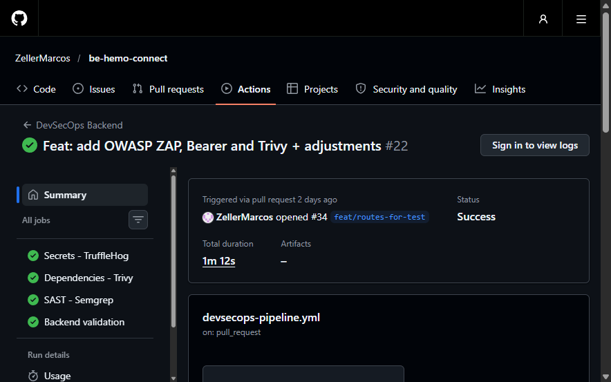

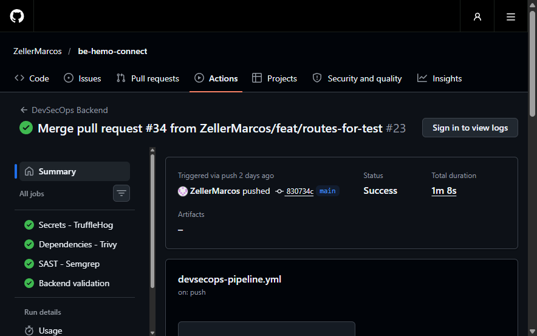

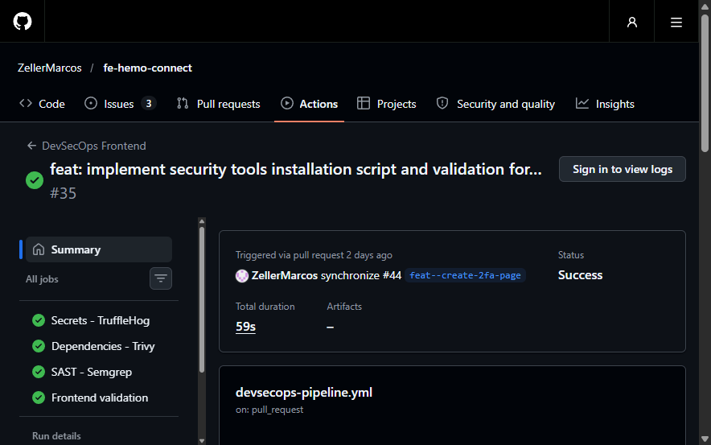

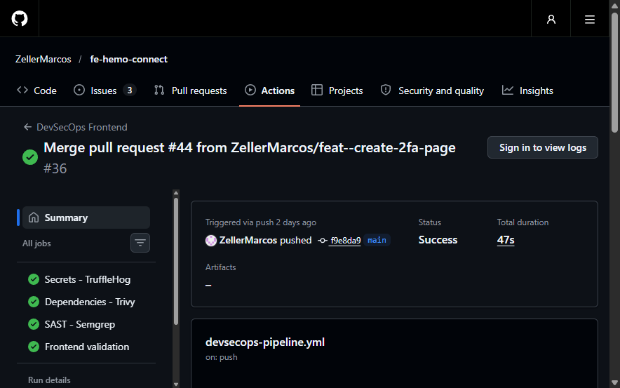

A tela de checks dos PRs nao foi incluida porque, apos o merge, o GitHub deixa de exibir o bloco de checks na conversa; as execucoes do evento `pull_request` acima cumprem esse papel. As imagens da esteira avancada (ZAP, Bearer e SBOM) estao na secao 5.1.

**Alertas de Dependabot ou CodeQL:** nao foram consultados nesta versao, pois a consulta exige autenticacao. Se existirem, devem ser registrados com identificador, severidade, componente, impacto e mitigacao, sem expor valores de credenciais.

**Teste local controlado do gate do Trivy:** em 05/11/2026, um lockfile sintetico fixando `vite 7.3.6` foi analisado com o Trivy 0.76.1 e as mesmas severidades da esteira. Resultado: CVE-2026-112942, severidade HIGH, e codigo de saida 1. Isso reproduz o bloqueio ocorrido na pipeline; nao representa vulnerabilidade presente no codigo atual, que usa `vite 7.3.7`.

### 5.1 Evidencias da esteira avancada

Frontend: execucao 41639828429 em `main`, commit `f9e8da9f6f1a224ff4e71dc087561d18afe58d2c`, iniciada em 03/11/2026 as 12:55:38 UTC; os tres jobs terminaram com sucesso (https://github.com/ZellerMarcos/fe-hemo-connect/actions/runs/41639828429). Backend: tres jobs aprovados no PR #34, execucao 41640068061, commit `cd323b0449f183eebb3d11537ff3ab5134584a81` (https://github.com/ZellerMarcos/be-hemo-connect/actions/runs/41640068061). Os runs diferem dos da esteira basica por serem workflows distintos sobre os mesmos commits. Horarios remotos em UTC.

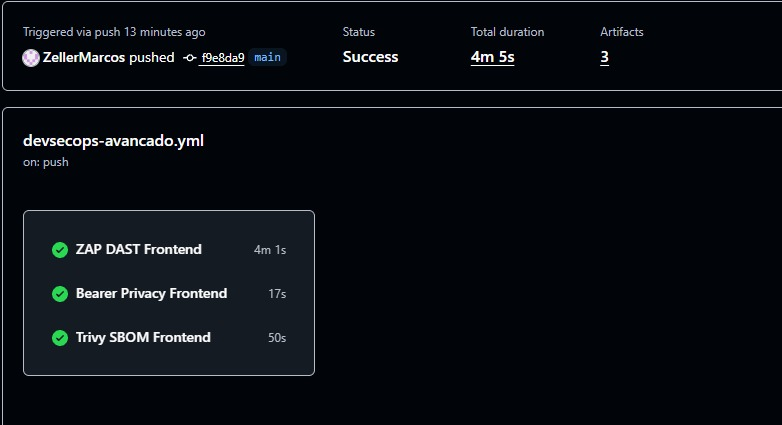

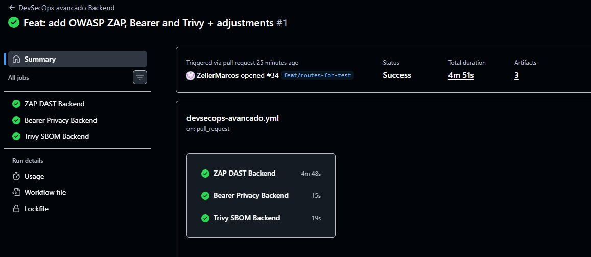

As Figuras A1 e A2 mostram status Success e tres artefatos por execucao (4 min 5 s no frontend e 4 min 51 s no backend); a A2 comprova os jobs verdes na execucao do PR, nao em `main`.

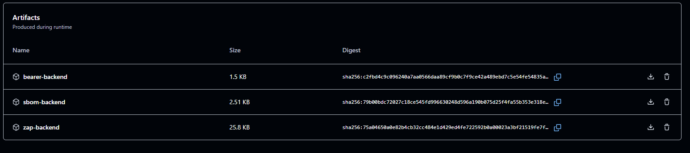

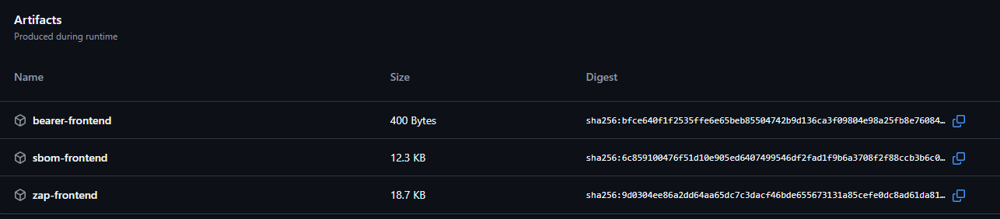

A origem das Figuras A3 e A4 foi correlacionada pelos metadados da API, pois as capturas nao incluem URL ou cabecalho; a A4 nao mostra o controle de download, cuja disponibilidade foi comprovada pelo download real do ZIP.

Os SBOMs foram baixados do GitHub Actions, extraidos e validados, e o SHA-256 de cada ZIP corresponde ao digest informado pelo GitHub:

| Evidencia remota | Validacao |
| --- | --- |
| sbom-backend.zip (execucao 41641064293 em main, commit 830734c) | Artefato 13233231508; CycloneDX 1.7; 34 componentes. |
| sbom-frontend.zip (execucao 41639828429) | Artefato 13232541097; CycloneDX 1.7; 276 componentes. |

O backend remoto tem 34 componentes e o inventario local anterior tem 35: sao snapshots distintos de ambiente e resolucao. Os artefatos consultados expiram em 17/11/2026.

Capturas dos relatorios HTML **locais** do ZAP (nao sao jobs do Actions):

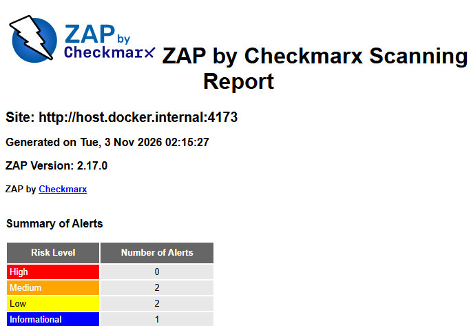

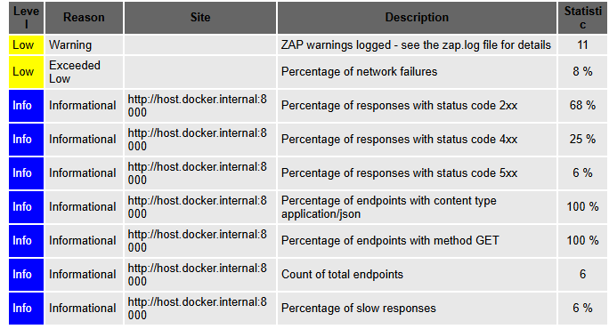

Os relatorios brutos (SBOMs, ZAP, Bearer e gates) ficam no [repositorio backend](https://github.com/ZellerMarcos/be-hemo-connect/tree/main/docs/evidencias/devsecops-avancado).

**Validacoes locais:**

| Verificacao | Resultado |
| --- | --- |
| actionlint 1.7.12 nos dois workflows | Aprovado. |
| Gates e preparacao do backend | 11 testes aprovados, incluindo validacao dos e-mails sinteticos. |
| Gates do frontend | 6 testes aprovados. |
| Regressao auth/usuarios/proxy | 74 testes aprovados; 6 avisos preexistentes. |
| Frontend lint e build | Aprovados; aviso preexistente de bundle de cerca de 1,08 MB. |
| ZAP (frontend e dois perfis do backend) | Execucoes reais concluidas e gates aprovados; limitacoes em 2.4. |
| Bearer nos dois repositorios | Execucoes reais concluidas; 4 Medium no backend e duas excecoes pontuais no frontend. |
| Bearer sintetico e ZAP alvo indisponivel | Critical real e exit-code 1; scanner exit 2 e gate exit 1. |
| SBOMs e gates | Backend 35 e frontend 276 componentes. |
| Shell Linux | Arquivos `.sh` fixados em LF via `.gitattributes`. |

Nao houve comprovacao de PR bloqueado por ZAP ou Bearer; o print opcional desse bloqueio nao e apresentado como ocorrido.

## 6. Politica de bloqueio

| Categoria | Politica | Situacao verificada |
| --- | --- | --- |
| TruffleHog | Falha quando reporta credencial verificada (`--fail`). | Configurado; cobertura limitada a credenciais verificaveis. |
| Trivy LOW ou MEDIUM | Nao bloqueia. | Configurado. |
| Trivy HIGH ou CRITICAL | Bloqueia com `exit-code: 1`. | Configurado; bloqueio observado na pipeline (vite 7.3.6) e reproduzido localmente. |
| Semgrep INFO ou WARNING | Nao bloqueia. | Configurado. |
| Semgrep ERROR | Bloqueia com `--error`. | Configurado; nenhum achado ERROR nas execucoes aprovadas. |
| ZAP High, erro do framework ou relatorio ausente/invalido | Bloqueia com `exit-code 1`. | Configurado; gate negativo testado com alvo indisponivel. |
| Bearer Critical | Bloqueia com `exit-code 1`; demais severidades apenas reportadas. | Configurado; gate testado com fixture sintetica. |
| SBOM invalido, vazio ou sem versoes | Bloqueia pelo gate da aplicacao. | Configurado; testes sinteticos e SBOMs reais validados. |

**Protecao da branch main (Ruleset ativo):** em 05/11/2026, antes da configuracao, a API publica indicava `main` sem protecao nos dois repositorios. Em seguida foi criado, em cada repositorio, o Ruleset `proteger-main` (status Active, alvo: branch padrao `main`). A consulta publica `GET /repos/ZellerMarcos/{repositorio}/rules/branches/main` confirma as regras ativas:

| Regra | Efeito |
| --- | --- |
| Restrict deletions | Impede apagar a `main`. |
| Block force pushes | Impede reescrever o historico da `main`. |
| Require a pull request before merging | Alteracoes entram por Pull Request (0 aprovacoes exigidas). |
| Require status checks to pass | Exige `Secrets - TruffleHog`, `Dependencies - Trivy`, `SAST - Semgrep` e `Backend validation` (backend) ou `Frontend validation` (frontend), com a branch atualizada antes do merge (`strict`). |

Assim, um job vermelho (Trivy HIGH/CRITICAL, Semgrep ERROR ou segredo verificado) deixa de ser apenas um aviso e passa a impedir o merge na `main`.

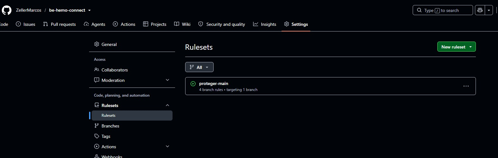

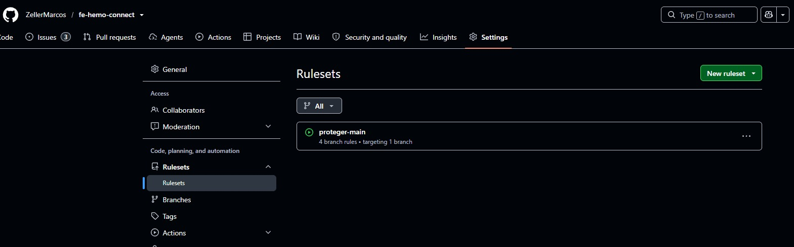

**Limite:** o bloqueio ainda nao foi exercitado com um Pull Request de check vermelho apos a criacao do Ruleset; a evidencia atual e a configuracao ativa, confirmada pela API. Sem regra de aprovacao de revisores, o autor pode aprovar o proprio PR, e a lista de bypass deve permanecer vazia para a regra valer tambem para o dono do repositorio.

**Lacuna:** o Ruleset exige apenas os quatro checks da esteira basica. Os jobs da esteira avancada (ZAP, Bearer e SBOM) executam e aprovam, mas ainda nao sao checks obrigatorios; merge bem-sucedido nao comprova bloqueio de futuros merges com falha nesses jobs.

## 7. Resultados

- Os quatro jobs de cada repositorio foram aprovados nas execucoes de pull request e de merge listadas na secao 5.
- Houve um bloqueio real pelo Trivy no frontend (vite 7.3.6, HIGH), corrigido com a atualizacao para 7.3.7.
- Ruleset `proteger-main` ativo nos dois repositorios, exigindo Pull Request e os checks de seguranca e validacao.
- Pendencias para a entrega completa: confirmacao do documento-base e publicacao da release.
- Esteira avancada: tres jobs (ZAP, Bearer e SBOM) aprovados nos dois repositorios, com SBOMs CycloneDX 1.7 baixados e validados (34 e 276 componentes).
- ZAP sem High, mas com degradacao (500 por identificadores fora da faixa INTEGER, 8% de falhas de rede e 6% de 5xx); Bearer com 4 Medium no backend e 2 falsos positivos suprimidos no frontend.

**Etapas ainda em aberto:**

1. Alinhar com o docente a ressalva da licenca ELv2 do Bearer.
2. Triar os identificadores fora da faixa INTEGER e as falhas de rede do ZAP no backend; corrigir com teste PostgreSQL quando autorizado e repetir os scans afetados.
3. Revisar os Medium do ZAP e do Bearer e os titulares Unknown, sem desativar regras para obter verde.
4. Incluir ZAP, Bearer e SBOM nos checks obrigatorios do Ruleset `proteger-main` e confirmar, com um PR de check vermelho, que a falha impede o merge.
5. Confirmar o documento-base e publicar a release.

## 8. Conclusao

A esteira automatiza a verificacao de segredos, CVEs, padroes de codigo inseguro, comportamento dinamico (DAST), privacidade e inventario de dependencias (SBOM), alem de confirmar testes e build, reduzindo o risco de mudancas inseguras chegarem a `main`. Ela nao torna o sistema automaticamente seguro: revisao de codigo, rotacao de segredos, correcao de achados e, e a manutencao da protecao de branch que torna os checks obrigatorios continuam necessarias.

## 9. Referencias

Consulta em 02/11/2026.

- OWASP ZAP Automation Framework: https://www.zaproxy.org/docs/automate/automation-framework/
- OWASP ZAP exitStatus: https://www.zaproxy.org/docs/desktop/addons/automation-framework/job-exitstatus/
- OWASP ZAP OpenAPI: https://www.zaproxy.org/docs/desktop/addons/openapi-support/automation/
- Bearer, comandos: https://docs.bearer.com/reference/commands/
- Bearer, linguagens suportadas: https://docs.bearer.com/reference/supported-languages/
- Licenca do Bearer: https://github.com/Bearer/bearer/blob/v2.1.3/LICENSE.txt
- Elastic, licencas nao OSI e alternativas: https://www.elastic.co/pricing/faq/licensing
- Pacote de regras fixado: https://github.com/Bearer/bearer-rules/tree/82c335f781a61a6d8b052394f84fd1d93edec467
- Trivy Python: https://trivy.dev/docs/latest/coverage/language/python/
- Trivy filesystem: https://trivy.dev/docs/latest/target/filesystem/
- GitHub Actions custos: https://docs.github.com/en/actions/concepts/billing-and-usage
- LGPD, Lei 13.709/2018: https://www.planalto.gov.br/ccivil_03/_ato2015-2018/2018/lei/l13709.htm
